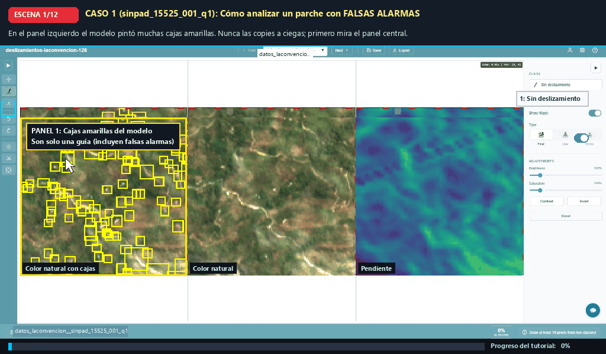
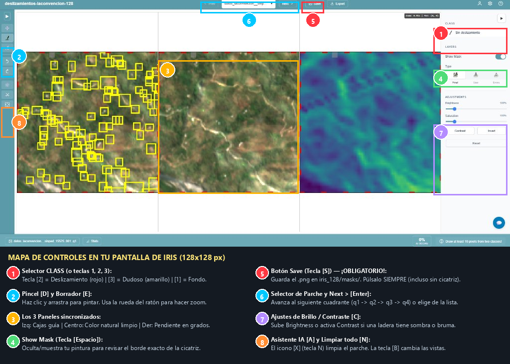
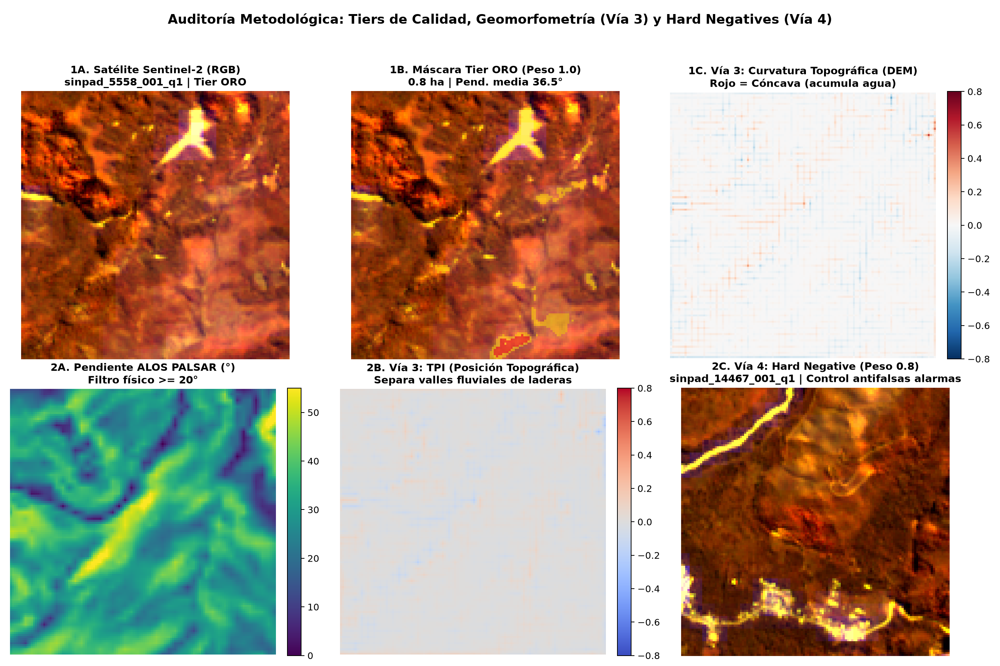

# Detección y Segmentación de Deslizamientos en La Convención (Cusco, Perú)

Repositorio de investigación para la detección semiautomática de cicatrices de deslizamientos mediante imágenes satelitales **Sentinel-2 L2A**, modelos de elevación **ALOS PALSAR / NASADEM** y redes neuronales de segmentación (**U-Net ResNet-34** y **DeepLabV3+**).

---

## Estructura del repositorio

```text
Tesis-La-Convencion-PE/
├── docs/                           # Documentación y material visual de referencia
│   ├── GUIA_IRIS_128.md            # Manual operativo de etiquetado a 128x128 px
│   └── img/                        # Figuras de auditoría y demostración en IRIS
├── herramientas/                   # Scripts de procesamiento, entrenamiento y pruebas
│   ├── ajuste_fino.py              # Entrenamiento con pesos estratificados y geomorfometría
│   ├── aumentar_d4_tiers.py        # Aumento geofísico invariante (grupo diedral D4)
│   ├── clasificar_tiers_y_expandir.py
│   ├── exportar_poligonos_qgis.py  # Vectorización suavizada (Chaikin) y estilo .qml
│   ├── minar_hard_negatives.py     # Minería activa de negativos difíciles
│   ├── nutrir_mascaras.py          # Extracción multitemporal y geológica
│   ├── pipeline_entrenamiento.py   # Entrenamiento, ajuste fino y exportación ONNX
│   ├── empaquetar_para_colab.py    # Empaquetado para ejecución en GPU (Colab)
│   ├── Ajuste_Fino_LaConvencion.ipynb
│   └── test_herramientas.py        # Suite de pruebas unitarias e integrales (9/9)
├── nucleo/                         # Módulo base de configuración, modelos y recetas
│   ├── config.py
│   ├── modelos.py
│   └── recetas.py                  # Normalización espectral y cálculo de CURVATURA / TPI
├── resultados/                     # Salidas cartográficas y catálogos consolidados
│   ├── cicatrices_consolidadas_qgis.geojson
│   ├── cicatrices_consolidadas_qgis.qml
│   ├── cicatrices_consolidadas_resumen.csv
│   ├── catalogo_parches_tiers.csv
│   ├── mascaras_nivel2_completo.csv
│   └── particion.csv
├── escala_laconvencion.json        # Constantes de normalización espectral provincial
├── iniciar_iris_128.bat            # Lanzador local de la interfaz de etiquetado IRIS
└── README.md
```

---

## Metodología y especificaciones técnicas

| Componente | Especificación |
| :--- | :--- |
| **Fuente satelital** | Sentinel-2 L2A (temporada seca junio–septiembre), corrección BOA |
| **Relieve** | DEM ALOS PALSAR / NASADEM remuestreado a malla UTM 18S (10 m/px) |
| **Parches de entrada** | Ventanas de $128 \times 128\text{ px}$ ($1{,}28 \times 1{,}28\text{ km}$) |
| **Canales base (6)** | `B01`, `B02`, `B03`, `B04`, `pendiente` (grados) y `elevacion` (m) |
| **Variables derivadas** | `GRVI`, `ExG`, `CURVATURA` laplaciana del DEM y `TPI` (ventana $5 \times 5$) |
| **Arquitecturas** | U-Net ResNet-34 v4 (IoU L4S: $0{,}4602$) y DeepLabV3+ ResNet-34 (ensamble: $0{,}4656$) |

---

## Etiquetado en IRIS ($128 \times 128$)

Para la validación y refinamiento humano de máscaras se utiliza la interfaz **IRIS** (*Intelligent Remote Sensing Image Segmentation*) configurada a $128 \times 128\text{ px}$ (guía detallada en [`docs/GUIA_IRIS_128.md`](docs/GUIA_IRIS_128.md)).

### Instalación y ejecución de IRIS

Requiere **Python 3.10+** y **Node.js (npm)**:

```powershell
# 1. Clonar el código fuente de IRIS en iris_app/
git clone https://github.com/gt-csse/iris.git iris_app

# 2. Instalar dependencias de Python y el paquete IRIS
pip install -e iris_app
pip install rasterio scikit-learn matplotlib pillow scipy

# 3. Compilar la interfaz web (React / Vite)
npm --prefix iris_app install
npm --prefix iris_app run build
```

Para exportar los parches, iniciar el servidor local e importar las máscaras validadas:

```powershell
# Exportar proyecto a iris_128/
python herramientas/iris_128.py exportar --salida iris_128

# Iniciar el servidor web local (o hacer doble clic en iniciar_iris_128.bat)
python herramientas/iris_128.py abrir --iris iris_128
# Abrir en el navegador: http://127.0.0.1:5000/segmentation/ (usuario: admin | clave: laconvencion)

# Importar las máscaras guardadas a Nivel 1
python herramientas/iris_128.py importar --iris iris_128 --salida mascaras_nivel1
```





---

## Auditoría de calidad y resultados consolidados

Las máscaras multitemporales (2018–2025, eventos INDECI y cartografía geológica de INGEMMET) se filtran mediante compacidad morfológica ($\text{área}/\text{perímetro} \ge 1{,}38\text{ px}$) y se estratifican en niveles de confianza (**Oro**, **Plata**, **Bronce** y **Hard Negatives**):



### Resumen cuantitativo del conjunto de entrenamiento

| Etapa / Artefacto | Resultado | Archivo en repositorio |
| :--- | :--- | :--- |
| **Teselas procesadas** | 353 teselas (96 con cicatrices propuestas, 783,3 ha) | [`resultados/mascaras_nivel2_completo.csv`](resultados/mascaras_nivel2_completo.csv) |
| **Ventana deslizante + Tiers** | 310 parches centrados nuevos (196 Tier Oro, 125 Tier Plata) | [`resultados/catalogo_parches_tiers.csv`](resultados/catalogo_parches_tiers.csv) |
| **Aumento geofísico $D_4$** | 2,003 parches positivos vs 577 negativos (total: 2,580 parches) | [`herramientas/aumentar_d4_tiers.py`](herramientas/aumentar_d4_tiers.py) |
| **Minería de negativos difíciles** | 443 negativos difíciles identificados (peso de pérdida `0.8`) | [`herramientas/minar_hard_negatives.py`](herramientas/minar_hard_negatives.py) |
| **Polígonos suavizados (QGIS)** | 499 polígonos (409 Oro, 58 Plata, 32 Bronce; 609,1 ha) | [`resultados/cicatrices_consolidadas_qgis.geojson`](resultados/cicatrices_consolidadas_qgis.geojson) |
| **Control ciego inter-anotador** | 3 teselas reservadas intactas (`15525`, `48878`, `557`) | [`herramientas/acuerdo_anotadores.py`](herramientas/acuerdo_anotadores.py) |

---

## Verificación automática

```powershell
python herramientas/test_herramientas.py
```

Todas las pruebas unitarias e integrales (partición espacial sin fuga, regla de nubes, métricas de acuerdo inter-anotador, cálculo geomorfométrico de `CURVATURA`/`TPI`, pesos por Tier y suavizado cartográfico de Chaikin) pasan al 100% (`9/9 OK`).

---

## Entrenamiento, ajuste fino y exportación ONNX

El flujo de modelado se divide en **cuatro etapas secuenciales y reproducibles**, diseñadas para entrenar y contrastar **U-Net (ResNet-34)** y **DeepLabV3+ (ResNet-34)** hasta obtener los archivos finales **ONNX** (`.onnx`) y sus recetas `.json` para despliegue en producción.

### Etapa 1. Entrenamiento base global (`herramientas/entrenar.py`)
* **Objetivo:** Dotar al *encoder* ResNet-34 (pre-entrenado en ImageNet) de capacidad general para reconocer deslizamientos a partir de los 3,799 parches de *Landslide4Sense*.
* **Configuración técnica:**
  * **Función de pérdida:** Combinación de *Binary Cross-Entropy* con *Online Hard Example Mining* (`--ohem 0.25`) y *Dice Loss* (`--peso-dice 0.5`).
  * **Índices internos (`--indices-verdor`):** Calcula `GRVI` y `ExG` dentro del propio grafo de la red, de modo que viajan compilados dentro del `.onnx`.
  * **Estabilización:** Promedio móvil exponencial de pesos (`--ema 0.999`), calentamiento de tasa de aprendizaje (`--calentamiento 5`) y promediado de las 5 mejores épocas (`--promediar 5`).
* **Salidas:** Checkpoint `.pt` y estadísticas de normalización `stats_norm_<firma>.json`.

### Etapa 2. Ajuste fino en La Convención (`herramientas/ajuste_fino.py`)
* **Objetivo:** Especializar el modelo base a la geomorfología y reflectancia andino-amazónica de La Convención sin olvidar lo aprendido en *Landslide4Sense*.
* **Configuración técnica:**
  * **Lotes mixtos (`--frac-local 0.5`):** Cada lote combina 50% de parches locales de La Convención (los **2,580 parches** balanceados con simetría $D_4$) y 50% de *Landslide4Sense* como ancla.
  * **Pérdida estratificada por Tiers:** Aplica el peso de `resultados/catalogo_parches_tiers.csv` por parche (`1.0` Tier Oro, `0.8` *Hard Negatives*, `0.5` Tier Plata, `0.3`/`0.2` Tier Bronce) e ignora píxeles `255` (nubes/dudosos).
  * **Tasa baja (`--lr 3e-5`):** Diez veces menor que el entrenamiento base para refinar pesos sin destruir el *encoder*; admite `--geomorfologia` para expandir la primera capa (`conv1`) e incorporar `CURVATURA` y `TPI`.
  * **Criterio de aceptación:** Solo guarda un nuevo modelo si mejora en validación local sin caer más de `0.03` de IoU en *Landslide4Sense*.

### Etapa 3. Comparación de arquitecturas (`pipeline_entrenamiento.py`)
* **Objetivo:** Contrastar rigurosamente **U-Net ResNet-34** (precisión en bordes mediante *skip connections*) frente a **DeepLabV3+ ResNet-34** (contexto multiescala mediante *Atrous Spatial Pyramid Pooling*) y frente a la línea base física sin aprendizaje (regla espectral + pendiente).

### Etapa 4. Exportación y verificación ONNX (`exportar_onnx.py` y `verificar_onnx.py`)
* **Objetivo:** Compilar ambos modelos (`.pt` $\rightarrow$ `.onnx`) junto con su receta `.json` (orden de canales, constantes de normalización, tipo de salida y umbral óptimo), verificando que la inferencia en `onnxruntime` reproduzca exactamente las métricas de PyTorch.

### Comandos de ejecución

```powershell
# 1. Benchmark comparativo completo: entrena U-Net ResNet-34 y DeepLabV3+ ResNet-34,
#    exporta ambos modelos a formato ONNX y verifica sus métricas oficiales
python herramientas/pipeline_entrenamiento.py comparativo --l4s /ruta/l4s

# 2. Entrenamiento base individual (unet o deeplabv3plus) + ONNX
python herramientas/pipeline_entrenamiento.py base --l4s /ruta/l4s --arquitectura unet

# 3. Ajuste fino en La Convención (2,580 parches estratificados + Hard Negatives + Vía 3)
#    y exportación automática del ONNX ajustado
python herramientas/pipeline_entrenamiento.py ajuste \
    --l4s /ruta/l4s \
    --desde /ruta/mejor_unet_b1b4b13b14.pt \
    --stats /ruta/stats_norm.json \
    --geomorfologia
```

*(Para ejecución en GPU gratuita de Google Colab, utilizar el cuaderno sincronizado [`herramientas/Ajuste_Fino_LaConvencion.ipynb`](herramientas/Ajuste_Fino_LaConvencion.ipynb)).*

