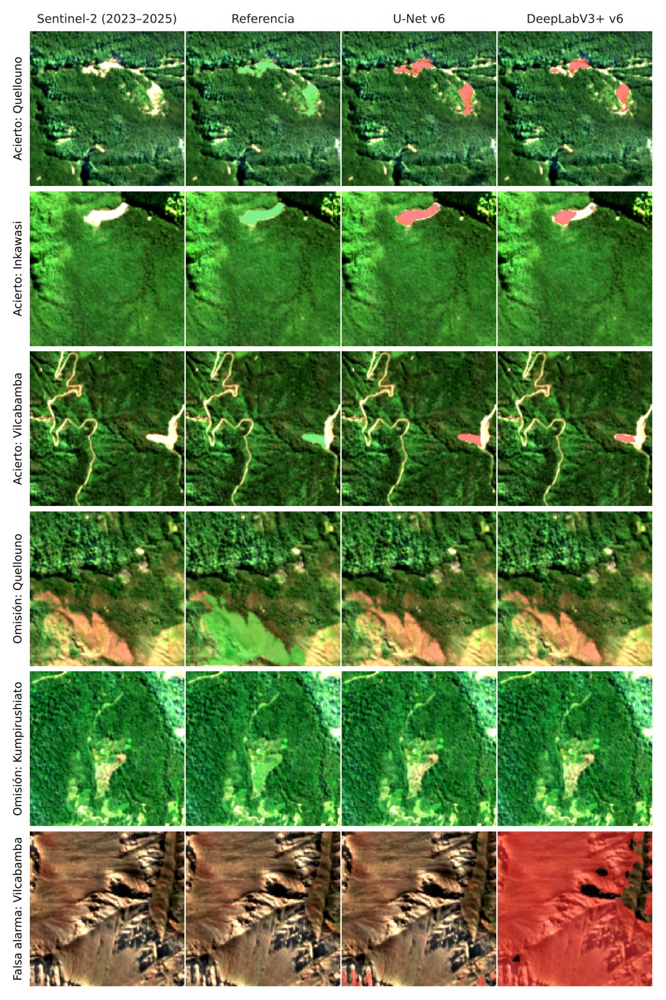
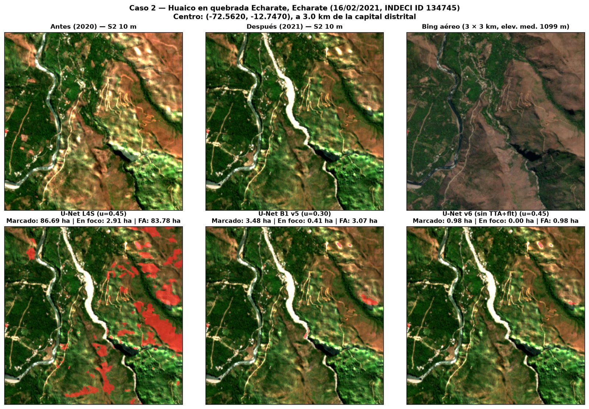

# Deslizamientos en La Convención, Cusco

Este repositorio reúne los datos, el código y los resultados de nuestra tesis de Ingeniería Informática en la Universidad Peruana Cayetano Heredia. El objetivo fue detectar cicatrices de deslizamientos en la provincia de La Convención con imágenes Sentinel-2 y redes de segmentación (U-Net y DeepLabV3+), ajustando los modelos solo con datos del Perú.

**Autores:** Víctor Nikolai Huarcaya Pumacayo y Leonardo Camilo Mejía López
**Asesor:** Mg. Roy Marco Yali Samaniego
**Aplicación web:** [Proyecto_Tesis_Deslizamiento](https://github.com/VictorNikolai/Proyecto_Tesis_Deslizamiento)

## Por qué La Convención

La provincia tiene relieve muy empinado, selva en la parte baja y lluvias fuertes entre enero y abril. INDECI registra cientos de deslizamientos, huaicos y derrumbes en los últimos años, pero casi siempre ubicados en la capital del distrito, no en la cicatriz. Los modelos entrenados con datos de otros países, aplicados tal cual aquí, marcaban cualquier ladera seca o techo como deslizamiento. Por eso armamos un conjunto propio de la provincia.

## Los datos

Descargamos teselas de 2.56 × 2.56 km (256 × 256 px a 10 m) y las cortamos en parches de 128 × 128 px. Cada parche tiene seis canales: bandas B01 a B04 de Sentinel-2, pendiente y elevación (NASADEM). La máscara usa 1 para deslizamiento, 0 para fondo y 255 para lo dudoso (nubes, sombras, cauces o carreteras), que no se cuenta.

Separamos entrenamiento, validación y prueba con al menos 3 km entre teselas para que el modelo nunca se evalúe en una zona que ya vio.


| Conjunto | Teselas | Parches | Cicatrices |
| :--- | ---: | ---: | ---: |
| Entrenamiento | 140 | 560 | 269 |
| Validación | 76 | 304 | 59 |
| Prueba (evaluada una sola vez) | 90 | 360 | 80 |
| Prueba 2 (negativos difíciles) | 141 | 564 | — |

Además usamos los 838 parches peruanos marcados por nuestro asesor (conjunto L4SPe), que sirven como referencia de un especialista. Las imágenes y máscaras no están en el repositorio por su tamaño (418 MB); se pueden pedir a los autores.

El marcado se hizo en IRIS adaptado a parches de 128 px, sin ver la salida de ningún modelo en validación y prueba. La guía está en [`docs/GUIA_IRIS_128.md`](docs/GUIA_IRIS_128.md).

## Resultados

En la prueba de La Convención, la U-Net ajustada pasó de un IoU de 0.011 a 0.131 y bajó las falsas alarmas de 12.5 a 0.22 ha/km². Detecta bien las cicatrices grandes (64 % de las mayores de 2 ha) y casi ninguna de las pequeñas. En la prueba del especialista llegó a un IoU de 0.430. DeepLabV3+ mejoró en la prueba del especialista (0.403), pero en La Convención se quedó en 0.019 por falsas alarmas en laderas altoandinas.

| Modelo | IoU La Convención | Falsas alarmas (ha/km²) | IoU especialista |
| :--- | ---: | ---: | ---: |
| U-Net sin datos peruanos | 0.011 | 12.47 | 0.356 |
| U-Net ajustada | **0.131** | **0.22** | **0.430** |
| DeepLabV3+ ajustada | 0.019 | 1.43 | 0.403 |

Algunos ejemplos de la prueba (referencia en verde, predicción en rojo): tres aciertos, dos omisiones y una falsa alarma de DeepLabV3+ en una ladera de roca y pajonal.



Una segunda versión agrega un filtro con el mapa de cobertura ESA WorldCover (zonas urbanas y de agua) y una comparación con la imagen de 2018–2020. Con eso, en 564 parches nuevos con terreno difícil (ríos, chacras, carreteras, poblados, laderas altas) las falsas alarmas bajaron de 0.095 a 0.021 ha/km².

### Un caso real: huaico de Echarate, febrero de 2021

Ubicamos la cicatriz comparando imágenes de antes y después, sin usar el modelo. Abajo, de izquierda a derecha: el modelo sin datos peruanos marca 87 ha, casi todo laderas secas; los modelos ajustados limpian esas falsas alarmas, pero tampoco marcan el huaico dentro del cauce.



### Lo que no funcionó

- No alcanzamos la meta inicial de IoU 0.70. La referencia que marcamos coincide con la del especialista en 0.30–0.39, así que ese es el techo de lo que se puede medir aquí.
- A 10 m, las cicatrices menores de unas 0.2 ha no se pueden marcar con consistencia, y los intentos de forzar al modelo a detectarlas solo aumentaron las falsas alarmas.
- Los huaicos dentro del cauce quedan sin marcar.

Los detalles están en [`informes/metricas_reformuladas.md`](informes/metricas_reformuladas.md) y [`informes/estudios_caso.md`](informes/estudios_caso.md).

## Modelos

Las recetas (canales, normalización, umbral y filtro) están en `modelos_ajustados/`. Los archivos ONNX se descargan desde la sección *Releases*.

- `unet_v6`: el que recomendamos (umbral 0.45, con filtro WorldCover).
- `deeplabv3plus_v6`: alternativa (umbral 0.60).
- `unet_b1_v5` y `deeplabv3plus_b2_v5`: los usados en la evaluación final.

## Cómo usarlo

```powershell
pip install torch segmentation-models-pytorch rasterio onnxruntime pystac-client planetary-computer pytest
pytest herramientas/test_herramientas.py -q
```

Las carpetas principales:

- `herramientas/`: descarga, corte de parches, marcado, partición, ajuste fino, exportación a ONNX y evaluación.
- `nucleo/`: configuración y recetas de normalización.
- `informes/`: resultados de cada etapa.
- `docs/`: guías y figuras.

El ajuste fino se corre con `herramientas/ajuste_fino.py` (opción `--sin-l4s` para usar solo datos peruanos) o desde el cuaderno `herramientas/Ajuste_Fino_LaConvencion.ipynb`.

## Cita

Huarcaya Pumacayo, V. N. y Mejía López, L. C. (2026). *Sistema de segmentación semántica basado en imágenes satelitales Sentinel-2 para la identificación de deslizamientos en La Convención, Cusco* [Tesis de pregrado]. Universidad Peruana Cayetano Heredia.

Datos usados: Sentinel-2 (Copernicus, vía Microsoft Planetary Computer), NASADEM, ESA WorldCover 2021, INGEMMET, INDECI y el conjunto L4SPe del Mg. Roy Marco Yali Samaniego.
