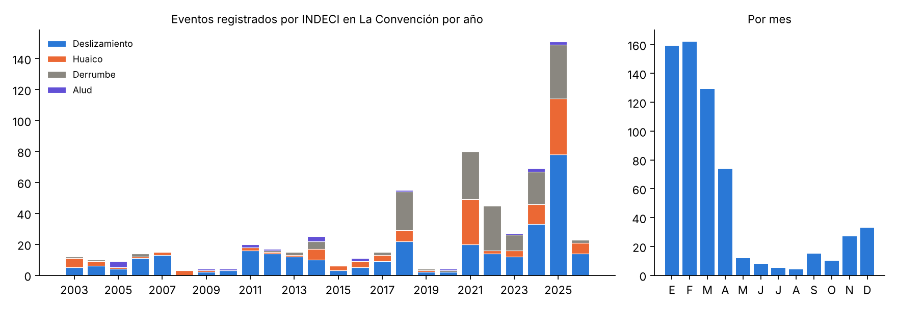
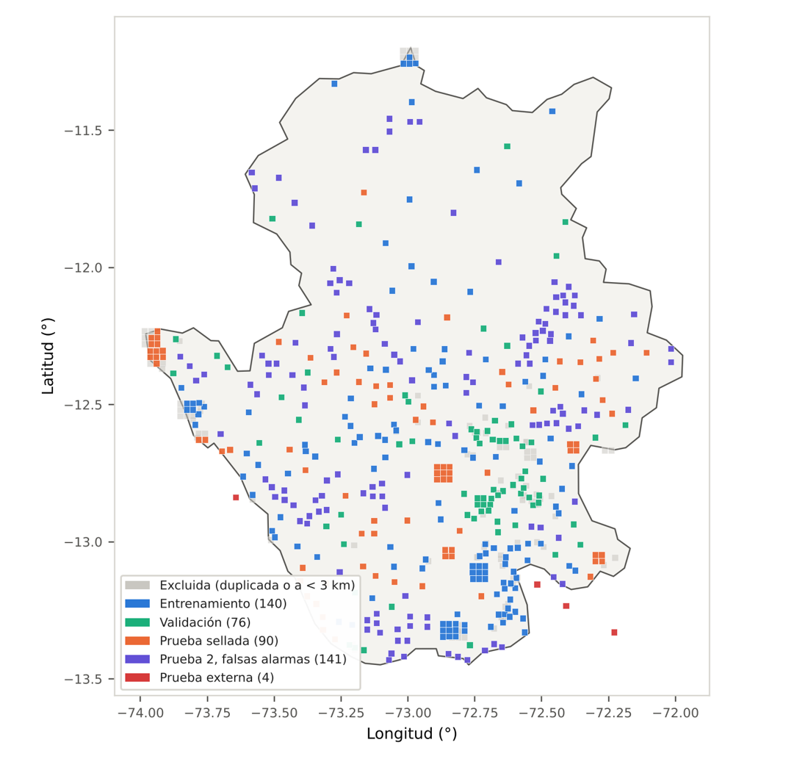

# Deslizamientos en La Convención, Cusco

Este repositorio reúne los datos, el código y los resultados de nuestra tesis de Ingeniería Informática en la Universidad Peruana Cayetano Heredia. El objetivo fue detectar cicatrices de deslizamientos en la provincia de La Convención con imágenes Sentinel-2 y redes de segmentación (U-Net y DeepLabV3+), ajustando los modelos solo con datos del Perú.

**Autores:** Víctor Nikolai Huarcaya Pumacayo y Leonardo Camilo Mejía López
**Asesor:** Mg. Roy Marco Yali Samaniego
**Aplicación web:** [Proyecto_Tesis_Deslizamiento](https://github.com/VictorNikolai/Proyecto_Tesis_Deslizamiento)

## Por qué La Convención

La provincia tiene relieve muy empinado, selva en la parte baja y lluvias fuertes entre enero y abril. La matriz de emergencias que nos entregó INDECI ([`datos/indeci_laconvencion_2003_2026.csv`](datos/indeci_laconvencion_2003_2026.csv)) tiene 638 eventos entre 2003 y 2026: 310 deslizamientos, 169 derrumbes, 138 huaicos y 21 aludes. El 82 % ocurrió entre enero y abril.



El problema es que casi todos los eventos están ubicados en la capital del distrito, no en la cicatriz. Los modelos entrenados con datos de otros países, aplicados tal cual aquí, marcaban cualquier ladera seca o techo como deslizamiento. Por eso armamos un conjunto propio de la provincia.

## Los datos

Descargamos teselas de 2.56 × 2.56 km (256 × 256 px a 10 m) y las cortamos en parches de 128 × 128 px. Cada parche tiene seis canales: bandas B01 a B04 de Sentinel-2, pendiente y elevación (NASADEM). La máscara usa 1 para deslizamiento, 0 para fondo y 255 para lo dudoso (nubes, sombras, cauces o carreteras), que no se cuenta.

Separamos entrenamiento, validación y prueba con al menos 3 km entre teselas para que el modelo nunca se evalúe en una zona que ya vio.



| Conjunto | Teselas | Parches | Cicatrices |
| :--- | ---: | ---: | ---: |
| Entrenamiento | 140 | 560 | 269 |
| Validación | 76 | 304 | 59 |
| Prueba (evaluada una sola vez) | 90 | 360 | 80 |
| Prueba 2 (negativos difíciles) | 141 | 564 | — |

Además usamos los 838 parches peruanos marcados por nuestro asesor (conjunto L4SPe), que sirven como referencia de un especialista. Las imágenes y máscaras no están en el repositorio por su tamaño (418 MB); se pueden pedir a los autores.

El marcado se hizo en IRIS adaptado a parches de 128 px, sin ver la salida de ningún modelo en validación y prueba. La guía está en [`docs/GUIA_IRIS_128.md`](docs/GUIA_IRIS_128.md).

## Cómo lo hicimos

1. **Elegir zonas.** Partimos de puntos de INDECI, de la cartografía de INGEMMET y de búsquedas de cambio de verdor entre años secos (2018–2020 frente a 2023–2025). También agregamos zonas al azar y zonas difíciles a propósito: ríos, chacras, carreteras, poblados y laderas altas sin deslizamientos.
2. **Descargar y componer.** Para cada tesela tomamos hasta seis escenas de temporada seca (junio a septiembre), quitamos nubes y sombras con la capa SCL y hicimos la mediana por píxel.
3. **Marcar.** Cada parche se marcó viendo cuatro vistas: la imagen actual, la de 2018–2020, la imagen aérea y la máscara. Las reglas principales: solo suelo desnudo con forma de cicatriz en ladera; nada de carreteras, cauces, playas, chacras ni nubes; ante la duda, «dudoso». En validación y prueba se marcó sin ver nunca la salida de un modelo.
4. **Separar en conjuntos.** Agrupamos las teselas por zonas y dejamos al menos 3 km entre entrenamiento, validación y prueba. Quitamos 72 teselas duplicadas o que se solapaban.
5. **Ajustar los modelos.** U-Net y DeepLabV3+ con codificador ResNet-34. En cada lote de 16 parches mezclamos 8 de La Convención y 8 del conjunto del especialista, con tasa de aprendizaje de 3e-5, entre 15 y 30 épocas y en CPU. La época y el umbral se eligen solo con validación (70 % especialista y 30 % La Convención).
6. **Evaluar una sola vez.** La prueba de 360 parches se usó una sola vez al final. Medimos IoU, F1, precisión y exhaustividad por píxel; detección por cicatriz (acierto si se cubre al menos el 30 %); falsas alarmas en hectáreas por km² de terreno sin deslizamientos; e intervalos de confianza remuestreando por zonas.
7. **Filtrar después del modelo.** Quitamos predicciones sobre zonas urbanas y de agua según ESA WorldCover y, opcionalmente, las que no muestran pérdida de verdor frente a 2018–2020 (chacras o pastos que rebrotaron).

## Resultados

En la prueba de La Convención, la U-Net ajustada pasó de un IoU de 0.011 a 0.131 y bajó las falsas alarmas de 12.5 a 0.22 ha/km². Detecta bien las cicatrices grandes (64 % de las mayores de 2 ha) y casi ninguna de las pequeñas. En la prueba del especialista llegó a un IoU de 0.430. DeepLabV3+ mejoró en la prueba del especialista (0.403), pero en La Convención se quedó en 0.019 por falsas alarmas en laderas altoandinas.

| Modelo | IoU La Convención | Falsas alarmas (ha/km²) | IoU especialista |
| :--- | ---: | ---: | ---: |
| U-Net sin datos peruanos | 0.011 | 12.47 | 0.356 |
| U-Net ajustada | **0.131** | **0.22** | **0.430** |
| DeepLabV3+ ajustada | 0.019 | 1.43 | 0.403 |

### Los mejores resultados

- **IoU de 0.430** (F1 de 60.1 %) de la U-Net en la prueba del especialista, frente a 0.356 del modelo sin datos peruanos.
- **75.7 % de F1** en esa misma prueba si se acepta un error de borde de 2 píxeles, justo sobre la meta de 75.5 % que nos habíamos puesto (con un margen que va de 70.1 % a 80.8 %).
- **82 % de los deslizamientos mayores de 2 ha** detectados en la prueba del especialista, y 64 % en la prueba de La Convención.
- **98 % menos falsas alarmas** en La Convención: de 12.5 a 0.22 ha/km².
- **0.021 ha/km²** de falsas alarmas en 349 parches nuevos con ríos, chacras, carreteras, poblados y laderas altas, con la versión que usa WorldCover.

Algunos ejemplos de la prueba (referencia en verde, predicción en rojo): tres aciertos, dos omisiones y una falsa alarma de DeepLabV3+ en una ladera de roca y pajonal.


Una segunda versión agrega un filtro con el mapa de cobertura ESA WorldCover (zonas urbanas y de agua) y una comparación con la imagen de 2018–2020. Con eso, en 564 parches nuevos con terreno difícil (ríos, chacras, carreteras, poblados, laderas altas) las falsas alarmas bajaron de 0.095 a 0.021 ha/km².

### Comprobación con eventos de INDECI

Para ver si el sistema funciona sobre eventos reales tomamos tres emergencias grandes de la matriz de INDECI. Como sus coordenadas son las de la capital del distrito, buscamos la cicatriz real comparando imágenes secas de antes y después del evento (sin usar el modelo) y la confirmamos en imagen aérea. Después corrimos los modelos en un área de 3 × 3 km alrededor.

| Evento INDECI | ¿Dónde está la cicatriz? | Sin datos peruanos | U-Net ajustada |
| :--- | :--- | :--- | :--- |
| Alud de Santa Teresa, 23/02/2020 (202 viviendas destruidas) | 9 km de la capital, quebrada Sahuayaco | La marca, pero con 5.1 ha falsas | La marca, con 0.15 ha falsas |
| Huaico de Echarate, 16/02/2021 | 3 km de la capital, en el cauce | La marca, pero con 83.8 ha falsas | Marca parte, 3.1 ha falsas |
| Deslizamiento de Vilcabamba, 27/03/2021 | 14 km de la capital, a 3 535 m | La marca, con 1.5 ha falsas | La marca, sin falsas alarmas |

En los tres casos el modelo ajustado reduce mucho las falsas alarmas: en Echarate pasa de 83.8 a 3.1 ha, unas 27 veces menos. El huaico de Echarate muestra el límite que ya veíamos: lo que corre por el fondo del cauce no se marca. El detalle de cada caso está en [`informes/estudios_caso.md`](informes/estudios_caso.md).

Así se ve el huaico de Echarate (antes, después, imagen aérea y las predicciones de los tres modelos):


### Lo que no funcionó

- No alcanzamos la meta inicial de IoU 0.70. La referencia que marcamos coincide con la del especialista en 0.30–0.39, así que ese es el techo de lo que se puede medir aquí.
- A 10 m, las cicatrices menores de unas 0.2 ha no se pueden marcar con consistencia, y los intentos de forzar al modelo a detectarlas solo aumentaron las falsas alarmas.
- Los huaicos dentro del cauce quedan sin marcar.

Los detalles están en [`informes/metricas_reformuladas.md`](informes/metricas_reformuladas.md) y [`informes/estudios_caso.md`](informes/estudios_caso.md).

## Qué falta

- Que el especialista revise una muestra de las máscaras de la prueba, para tener una medida con referencia humana en la misma provincia.
- Probar un modelo con más bandas (B08, B11 y B12), que podría separar mejor el suelo arcilloso de los pastos secos.
- Tratar los huaicos en cauce como una clase aparte.
- Usar imágenes de mayor resolución para los deslizamientos pequeños.

## Modelos

Las recetas (canales, normalización, umbral y filtro) están en `modelos_ajustados/`. Los archivos ONNX se descargan desde la sección *Releases*.

- `unet_v6`: el que recomendamos (umbral 0.45, con filtro WorldCover).
- `deeplabv3plus_v6`: alternativa (umbral 0.60).
- `unet_b1_v5` y `deeplabv3plus_b2_v5`: los usados en la evaluación final.

## Cómo usarlo

```powershell
pip install torch segmentation-models-pytorch rasterio onnxruntime pystac-client planetary-computer pytest
pytest herramientas/test_herramientas.py -q
```

Las carpetas principales:

- `herramientas/`: descarga, corte de parches, marcado, partición, ajuste fino, exportación a ONNX y evaluación.
- `nucleo/`: configuración y recetas de normalización.
- `informes/`: resultados de cada etapa.
- `docs/`: guías y figuras.

El ajuste fino se corre con `herramientas/ajuste_fino.py` (opción `--sin-l4s` para usar solo datos peruanos) o desde el cuaderno `herramientas/Ajuste_Fino_LaConvencion.ipynb`.

## Fuentes de datos

- **Sentinel-2 L2A** (Copernicus), descargado de Microsoft Planetary Computer: bandas B01 a B04 a 10 m, con la capa de nubes SCL para descartar nubes y sombras.
- **NASADEM**: pendiente y elevación remuestreadas a 10 m.
- **ESA WorldCover 2021**: cobertura del suelo para el filtro de zonas urbanas y de agua.
- **INDECI**: matriz de emergencias 2003–2026 de la provincia (incluida en `datos/`).
- **INGEMMET**: cartografía de peligros geológicos, usada para elegir zonas de búsqueda.
- **L4SPe**: 838 parches peruanos marcados por el Mg. Roy Marco Yali Samaniego.
