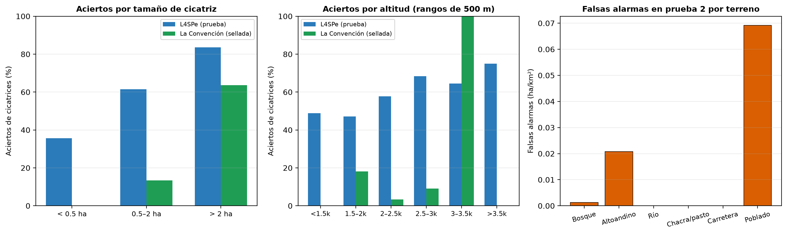

# Tarea B — Análisis de Errores de la Versión Final (`v9 + filtro IR (NDVI > 0.40)`)

> [!IMPORTANT]
> Evaluación **«post hoc»** sobre `La Convención sellada` (`360` parches), `L4SPe test` (`124` parches) y `prueba2` (`349` negativos confirmados).

## a) Aciertos y omisiones por tamaño de cicatriz
| Tamaño | `L4SPe test` (Aciertos / Omisiones / `%`) | `La Convención sellada` (Aciertos / Omisiones / `%`) |
|---|---:|---:|
| < 0.5 ha | 53 / 96 (35.6 %) | 0 / 54 (0.0 %) |
| 0.5–2 ha | 113 / 71 (61.4 %) | 2 / 13 (13.3 %) |
| > 2 ha | 61 / 12 (83.6 %) | 7 / 4 (63.6 %) |

## b1) Aciertos y omisiones por pendiente
| Pendiente | `L4SPe test` (Aciertos / Omisiones / `%`) | `La Convención sellada` (Aciertos / Omisiones / `%`) |
|---|---:|---:|
| < 20° | 0 / 4 (0.0 %) | 0 / 2 (0.0 %) |
| 20–30° | 9 / 19 (32.1 %) | 1 / 15 (6.2 %) |
| 30–40° | 27 / 31 (46.6 %) | 7 / 42 (14.3 %) |
| > 40° | 191 / 125 (60.4 %) | 1 / 12 (7.7 %) |

## b2) Aciertos y omisiones por altitud (rangos de `500 m`)
| Altitud | `L4SPe test` (Aciertos / Omisiones / `%`) | `La Convención sellada` (Aciertos / Omisiones / `%`) |
|---|---:|---:|
| < 1500 m | 43 / 45 (48.9 %) | 0 / 13 (0.0 %) |
| 1500–2000 m | 50 / 56 (47.2 %) | 2 / 9 (18.2 %) |
| 2000–2500 m | 56 / 41 (57.7 %) | 1 / 29 (3.3 %) |
| 2500–3000 m | 52 / 24 (68.4 %) | 2 / 20 (9.1 %) |
| 3000–3500 m | 20 / 11 (64.5 %) | 4 / 0 (100.0 %) |
| > 3500 m | 6 / 2 (75.0 %) | 0 / 0 (0.0 %) |

## c) Falsas alarmas por tipo de terreno (`prueba2`, `349` negativos)
| Tipo de terreno | `N` | Falsas alarmas (`ha/km²`) | `%` parches con marca |
|---|---:|---:|---:|
| Bosque | 243 | 0.0013 | 0.4 % |
| Altoandino | 49 | 0.0208 | 2.0 % |
| Río | 34 | 0.0000 | 0.0 % |
| Chacra/pasto | 9 | 0.0000 | 0.0 % |
| Carretera | 8 | 0.0000 | 0.0 % |
| Poblado | 6 | 0.0692 | 16.7 % |

