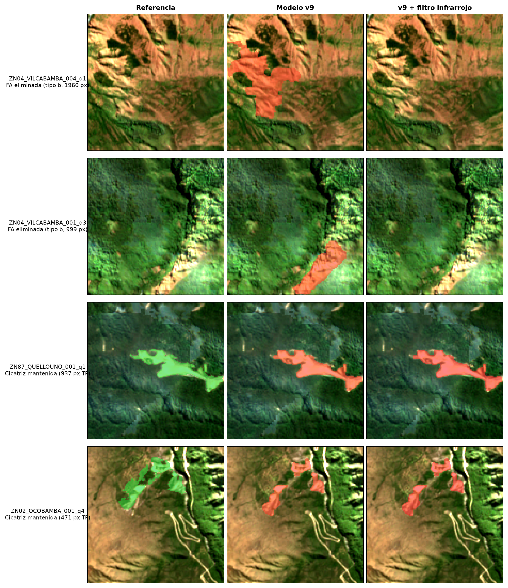

# Tarea A — Filtro Infrarrojo sobre la `v9`

> [!IMPORTANT]
> **Limitación:** `L4SPe` no dispone de bandas `B08, B11, B12`, por lo que el filtro infrarrojo se evalúa y aplica **únicamente sobre La Convención** (`validacion` 304, `prueba` 360 y `prueba2` 349 negativos). Toda elección de regla se hizo **exclusivamente en validación**.

## 1. Comparación de Índices en Validación (`La Convención val`, `304` parches)

- **Objetos `v9` en validación:** `TP = 3`, `FA = 19`.
- **Medias en cicatrices reales (`TP`):** `NDVI = 0.294`, `NDMI = -0.125`, `BSI = 0.160`, `B11/B12 = 1.392`.
- **Medias en falsas alarmas (`FA`):** `NDVI = 0.523`, `NDMI = 0.127`, `BSI = -0.073`, `B11/B12 = 1.618`.

### Reglas evaluadas en validación (top 6)
| Regla | `LC val` IoU | `FA LC val` (`ha/km²`) | Cicatrices perdidas | ¿Cumple? |
|---|---:|---:|---:|---|
| `NDVI > 0.40` | 0.1702 | 0.0158 | 0 | Sí |
| `NDVI > 0.45` | 0.1702 | 0.0158 | 0 | Sí |
| `BSI > 0.20` | 0.1654 | 0.0216 | 0 | Sí |
| `NDVI > 0.35` | 0.1345 | 0.0158 | 1 | Sí |
| `NDVI > 0.25` | 0.1061 | 0.0014 | 2 | No |
| `NDVI > 0.30` | 0.1061 | 0.0014 | 2 | No |

**Decisión en validación:** **SE APLICA** (`NDVI > 0.40`).

## 2. Comparación «Post Hoc» en `La Convención sellada` (`360`) y `prueba2` (`349` negativos)

| Modelo | IoU 0 px [IC 95 %] | F1 obj `≥ 0.5 ha` [IC 95 %] | Det `≥ 2 ha` [IC 95 %] | `prueba2` TOTAL (`ha/km²` / `%`) |
|---|---|---|---|---:|
| **v9** | 0.1455 [0.0456, 0.2860] | 34.7 % [13.6, 51.1] | 72.7 % [25.0, 100.0] | **0.0157 (2.3 %)** |
| **v9 + filtro IR (`NDVI > 0.40`)** | 0.1519 [0.0353, 0.3044] | 30.0 % [10.2, 50.0] | 63.6 % [14.3, 92.3] | **0.0050 (0.9 %)** |

### `prueba2` por tipo de terreno («post hoc»)
| Modelo | `bosque_ladera` | `altoandino` | `rio` | `chacra_o_pasto` | `carretera` | `poblado` |
|---|---:|---:|---:|---:|---:|---:|
| **v9** | 0.0084 | 0.0614 | 0.0000 | 0.0000 | 0.0000 | 0.0692 |
| **v9 + filtro IR** | 0.0013 | 0.0208 | 0.0000 | 0.0000 | 0.0000 | 0.0692 |

## 3. Eliminación sobre las `39` falsas alarmas completas de `fa_clasificacion_v9.csv`

| Tipo | Comp. `v9` | Eliminadas por filtro IR | Área `v9` (`ha`) | Área eliminada (`ha`) |
|---|---:|---:|---:|---:|
| `a` | 9 | **6** | 21.83 | 13.56 |
| `b` | 16 | **5** | 57.00 | 33.29 |
| `c` | 4 | **0** | 8.61 | 0.00 |
| `d` | 5 | **0** | 16.25 | 0.00 |
| `e` | 3 | **0** | 5.71 | 0.00 |
| `f` | 2 | **2** | 0.51 | 0.51 |

