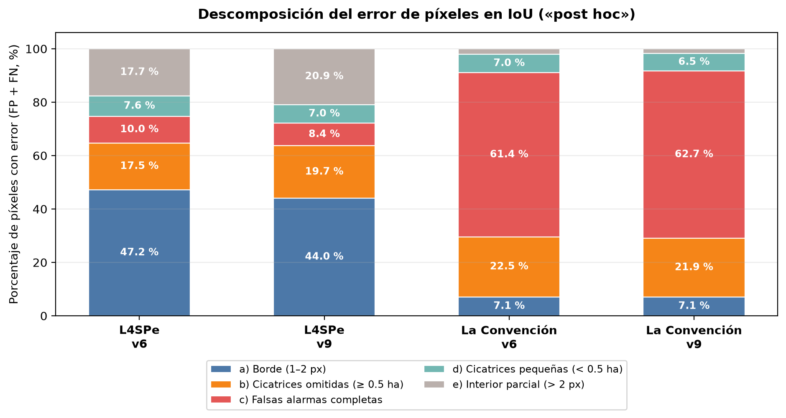

# Tarea 1 — Diagnóstico del IoU («post hoc»)

> [!IMPORTANT]
> Todas las cifras se miden sobre los conjuntos de prueba ya sellados (`L4SPe` test `124` parches y `La Convención` sellada `360` parches), por lo que se reportan como **«post hoc»**.

## Descomposición del error de píxeles (`FP + FN`) e IoU «oráculo» por componente

Cada píxel con error se asigna de forma excluyente a: `a)` borde (`1–2 px` del contorno de la referencia), `b)` cicatrices omitidas completas (`≥ 0.5 ha`, `0 px` tocados), `c)` falsas alarmas completas (componentes predichos que no tocan referencia), `d)` cicatrices pequeñas (`< 0.5 ha`), y `e)` interior parcial (`> 2 px` dentro de cicatrices grandes parcialmente detectadas).

| Conjunto | Modelo | IoU base | Error total (`FP + FN`) | `a)` Borde 1–2 px (`%` \| IoU oráculo) | `b)` Omitidas ≥ 0.5 ha (`%` \| IoU oráculo) | `c)` FA completas (`%` \| IoU oráculo) | `d)` Pequeñas < 0.5 ha (`%` \| IoU oráculo) | `e)` Interior > 2 px (`%` \| IoU oráculo) |
|---|---|---:|---:|---|---|---|---|---|
| L4SPe test | **v6** | `0.4229` | `45,204` px | 47.2 % \| `0.6528` (`+0.2299`) | 17.5 % \| `0.5239` (`+0.1010`) | 10.0 % \| `0.4489` (`+0.0260`) | 7.6 % \| `0.4667` (`+0.0437`) | 17.7 % \| `0.4827` (`+0.0598`) |
| L4SPe test | **v9** | `0.4298` | `47,853` px | 44.0 % \| `0.6211` (`+0.1913`) | 19.7 % \| `0.5423` (`+0.1125`) | 8.4 % \| `0.4515` (`+0.0217`) | 7.0 % \| `0.4697` (`+0.0399`) | 20.9 % \| `0.4953` (`+0.0655`) |
| La Convención sellada | **v6** | `0.1425` | `16,592` px | 7.1 % \| `0.1930` (`+0.0505`) | 22.5 % \| `0.3357` (`+0.1931`) | 61.4 % \| `0.3011` (`+0.1585`) | 7.0 % \| `0.2025` (`+0.0599`) | 1.9 % \| `0.1498` (`+0.0073`) |
| La Convención sellada | **v9** | `0.1455` | `17,521` px | 7.1 % \| `0.1812` (`+0.0357`) | 21.9 % \| `0.3324` (`+0.1869`) | 62.7 % \| `0.3136` (`+0.1681`) | 6.5 % \| `0.2012` (`+0.0557`) | 1.8 % \| `0.1525` (`+0.0070`) |

### Hallazgos principales del diagnóstico
- En **L4SPe test**, el mayor cuello de botella es el **borde a `1–2 px`** (`47.2 %` de todo el error en `v6` y `44.0 %` en `v9`): corregir solo el borde de `1–2 px` elevaría el IoU oráculo de `0.4229` a **`0.6528`** en `v6` (`+0.2299`) y de `0.4298` a **`0.6211`** en `v9` (`+0.1913`).
- En **La Convención sellada**, el error está dominado por **cicatrices grandes omitidas** y **falsas alarmas completas**, reflejo directo tanto de omisiones en sustratos pardo-rojizos/revegetados como de discrepancias de criterio y desalineación en la referencia de `10 m`.
